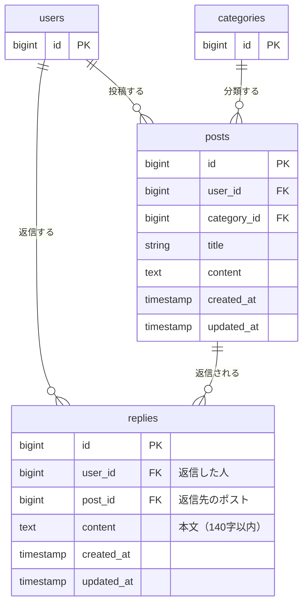
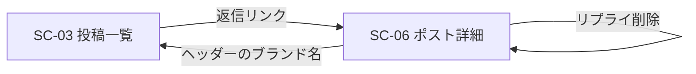

# リプライ機能 設計書

元になった Issue: [#1 ポストにリプライ機能を追加する](https://github.com/miyori-knzk/post-app-practice/issues/1)

## 概要

今のアプリは、ポストを読むだけで返す手段がない。ポストを読んだ人が、その場で一言返せるようにするため、リプライ機能を追加する。

- ポストを1件開く画面（ポスト詳細画面）を新しく作り、そこにポストとリプライの一覧、リプライの送信フォームを置く。
- ポスト詳細画面へは、投稿一覧の各ポストに付ける「返信」リンクから入る。
- リプライを消せるのは、そのリプライを書いた本人だけ。判定のやり方は `app/Policies/PostPolicy.php`（`$user->id === $post->user_id`）に揃える。
- リプライの本文はポストの本文と同じく140字以内にする。
- リプライ送信・削除のあとは、同じポスト詳細画面に戻る。

やらないこと・守ること:

- タイムライン（一覧・編集・削除）の既存の動きは変えない。一覧への変更は「返信」リンクの追加のみ。
- ポスト投稿者による他人のリプライの削除はできない（リプライの投稿者本人のみ）。
- リプライの編集、リプライへのリプライ（入れ子）、通知は今回の対象外。

## 受け入れ条件

| ID    | 条件                                                     |
| :---- | :------------------------------------------------------- |
| AC-01 | ポストを1件開くと、そのポストとリプライの一覧が見える    |
| AC-02 | 本文を入れてリプライを送ると、一覧に増える               |
| AC-03 | 本文が空のままだと、エラーが表示されてリプライは増えない |
| AC-04 | 自分のリプライは消せて、他人のリプライは消せない         |

補足として、次も満たす。

- 他人のリプライには削除ボタンを出さない。直接リクエストしても 403 で、リプライは残る。
- リプライが1件もないポストでは、「まだリプライがありません。」と表示する。
- リプライは古い順（`created_at` の昇順）に並べる。会話の流れが上から下に読めるため。
- ポストを削除したら、そのポストのリプライも一緒に消える。

## 変えないもの

タイムライン（`/posts`）の今の動きは変えない。

| 対象                   | 変えないこと                                                                                          |
| :--------------------- | :---------------------------------------------------------------------------------------------------- |
| 投稿一覧の表示         | 並び順（新しい順）、表示項目、eager load（`user` / `category`）。リプライの件数などは出さない         |
| 投稿の編集             | `posts.edit` / `posts.update` のルート、画面、140字制限、残り字数表示                                 |
| 投稿の削除             | `posts.destroy` の動きと、削除後に一覧へ戻ること。リプライがあっても削除できる                        |
| `PostPolicy`           | 変更しない。リプライの認可は新しい `ReplyPolicy` に分ける                                             |
| 認証・認可の方針       | `/posts` 系はすべて `auth` ミドルウェア内。Policy は命名規約による自動検出（`$policies` に登録しない） |
| 既存テーブル・既存データ | `users` / `categories` / `posts` のカラムは変えない                                                  |

一覧への変更は「返信」リンクの追加のみ。各ポストの操作欄に1つ足す。リンクは、投稿者本人かどうかに関係なく、ログインしている全員に出す（「編集」「削除」は今までどおり本人のみ）。

あわせて、次も守る。

- ポスト投稿者による他人のリプライの削除はできない。リプライを消せるのは、リプライの投稿者本人のみ。
- リプライの編集、リプライへのリプライ（入れ子）、通知は今回の対象外。

## 増えるテーブル

`replies` テーブルを1つ追加する。

`users` / `categories` は、関係を示すために主キーだけ描いている（今回は変更しない）。

### replies

| カラム       | 型               | NULL | 制約                                          | 説明                       |
| :----------- | :--------------- | :--- | :-------------------------------------------- | :------------------------- |
| `id`         | bigint unsigned  | 不可 | 主キー                                        |                            |
| `user_id`    | bigint unsigned  | 不可 | 外部キー（`users.id`）、削除時 cascade        | 返信した人                 |
| `post_id`    | bigint unsigned  | 不可 | 外部キー（`posts.id`）、削除時 cascade        | 返信先のポスト             |
| `content`    | text             | 不可 |                                               | 本文。140字以内（アプリ側で検証） |
| `created_at` | timestamp        | 可   |                                               |                            |
| `updated_at` | timestamp        | 可   |                                               |                            |

- `post_id` の cascade は決定事項「ポストが削除されたら、リプライも一緒に削除する」による。`user_id` の cascade は `posts.user_id` に揃える。
- 140字の上限は、`posts.content` と同じく DB ではなくアプリ側（バリデーション）で守る。値は `Post::CONTENT_MAX_LENGTH` を使い回し、リプライ用の定数を別に作らない。
- 「ポスト詳細画面でポスト単位に古い順で読む」ための並びは `post_id` の外部キーに付くインデックスで足りるので、追加のインデックスは作らない。

### リレーション

| モデル  | リレーション                                         |
| :------ | :--------------------------------------------------- |
| `Reply` | `user()`：`belongsTo(User)`、`post()`：`belongsTo(Post)` |
| `Post`  | `replies()`：`hasMany(Reply)`                        |
| `User`  | `replies()`：`hasMany(Reply)`                        |

## 増える画面

### 画面一覧への追加

| ID    | 画面名             | 役割                                                         | 主な利用者     |
| :---- | :----------------- | :----------------------------------------------------------- | :------------- |
| SC-06 | ポスト詳細画面     | ポスト1件とそのリプライを見て、リプライを送る・自分のリプライを消す画面 | ログインユーザ |

既存の画面の変更は SC-03（投稿一覧画面）のみ。各ポストの操作欄に「返信」リンクを足す。

### 画面の流れ

### SC-06 ポスト詳細画面

| 項目                     | 内容                                                                                                   |
| :----------------------- | :----------------------------------------------------------------------------------------------------- |
| URL                      | `GET /posts/{post}`（ルート名 `posts.show`）                                                           |
| アクセス条件             | ログイン済み（`auth`）。未ログインはログイン画面へ。存在しないポストは 404                              |
| ポストの表示             | 投稿者名、投稿日時、カテゴリ、タイトル、本文（一覧と同じ見せ方）。編集・削除ボタンは出さない           |
| リプライ一覧             | 古い順。1件ごとに、返信者名、日時、本文                                                                |
| リプライ一覧（0件のとき） | 「まだリプライがありません。」                                                                         |
| 削除ボタン               | 自分のリプライにだけ表示（`@can('delete', $reply)`）                                                  |
| 送信フォーム             | 本文の入力欄と「返信する」ボタン。残り字数の表示は付けない（今回は必須にしない）                       |
| エラー表示               | 送信フォームの下に、`content` のエラーメッセージを表示。入力した本文は残す（`old('content')`）         |
| 一覧に戻る導線           | ヘッダーのブランド名リンク（既存画面と同じ）                                                           |

### 追加するルート

すべて `auth` ミドルウェア内。

| 用途           | メソッドとパス               | ルート名          | コントローラ                | 認可                          | 成功時                       |
| :------------- | :--------------------------- | :---------------- | :-------------------------- | :---------------------------- | :--------------------------- |
| ポスト詳細     | `GET /posts/{post}`          | `posts.show`      | `PostController@show`       | なし（ログイン済みなら誰でも） | 詳細画面を表示               |
| リプライ送信   | `POST /posts/{post}/replies` | `replies.store`   | `ReplyController@store`     | なし（ログイン済みなら誰でも） | `posts.show` へリダイレクト  |
| リプライ削除   | `DELETE /replies/{reply}`    | `replies.destroy` | `ReplyController@destroy`   | `authorize('delete', $reply)` | その reply の `posts.show` へリダイレクト |

### 認可（ReplyPolicy）

`app/Policies/ReplyPolicy.php` を新設し、`PostPolicy` と同じ書き方にする。

| メソッド | 判定                                  |
| :------- | :------------------------------------ |
| `delete` | `$user->id === $reply->user_id`       |

`update` は、リプライの編集をやらないので作らない。

## 入力チェックとメッセージ一覧

### 入力チェック表（リプライ送信）

| 画面           | 項目 | 必須 | 文字数           | 形式・値の範囲 | ほかの項目との関係 |
| :------------- | :--- | :--- | :--------------- | :------------- | :----------------- |
| ポスト詳細画面 | 本文 (`content`) | 必須 | 140字以内 | 文字列         | -                  |

- 返信先のポストは、URL の `{post}`（ルートモデルバインディング）で決まる。フォームの入力項目ではない。
- 返信者は、ログイン中のユーザー。フォームから受け取らない。
- 本文は、前後の空白だけの入力も「空」として扱う（Laravel 標準の `TrimStrings` と `ConvertEmptyStringsToNull` により、必須エラーになる）。
- ブラウザは改行を `\r\n` で送るが、字数の数え方は改行を1字とする。`PostController::update` と同じく、検証の前に `\r\n` を `\n` に揃える。

### メッセージ一覧

| 場面                                   | 条件                                       | 表示の仕方                       | メッセージ                          |
| :------------------------------------- | :----------------------------------------- | :------------------------------- | :---------------------------------- |
| リプライ送信（本文が空）               | `content` が未入力・空白のみ               | 送信フォームの下に赤字で表示     | 本文を入力してください。            |
| リプライ送信（本文が長すぎる）         | `content` が141字以上                      | 送信フォームの下に赤字で表示     | 本文は140字以内で入力してください。 |
| 未ログインでアクセス                   | 詳細・送信・削除のどれでも                 | ログイン画面へリダイレクト       | （メッセージなし）                  |
| 他人のリプライを削除                   | `ReplyPolicy::delete` が false             | 403 エラー画面                   | Laravel 標準の 403 画面             |
| 存在しないポスト・リプライを指定       | `{post}` / `{reply}` が見つからない        | 404 エラー画面                   | Laravel 標準の 404 画面             |
| ポスト詳細（リプライなし）             | リプライが0件                              | リプライ一覧の場所に表示         | まだリプライがありません。          |

- 本文のエラーメッセージは、`PostController::update` の `content.required` / `content.max` と同じ文言・同じ作り方（`Post::CONTENT_MAX_LENGTH` から組み立てる）にする。
- エラーのとき、リプライは1件も増えない。

## テスト観点

`tests/Feature` に追加する（`PostContentLimitTest` と同じく `RefreshDatabase`、`setUp` で投稿者・カテゴリ・ポストを用意する）。

| 区分       | 観点                                                                          | 期待する結果                                              | 対応する条件 |
| :--------- | :---------------------------------------------------------------------------- | :-------------------------------------------------------- | :----------- |
| 表示       | 詳細画面を開く                                                                | ポストのタイトル・本文と、リプライの本文・返信者名が見える | AC-01        |
| 表示       | リプライが0件のポストの詳細画面を開く                                         | 「まだリプライがありません。」が見える                    | AC-01        |
| 表示       | リプライが複数あるときの並び                                                  | 古い順に並ぶ                                              | AC-01        |
| 表示       | 存在しないポストの詳細画面を開く                                              | 404                                                       | -            |
| 送信       | 本文を入れて送る                                                              | `replies` に1件増え、`user_id` はログインユーザー、`post_id` は対象ポスト。詳細画面にリダイレクトし、一覧に表示される | AC-02 |
| 送信       | 140字ちょうどの本文                                                           | 保存される                                                | AC-02        |
| 送信       | 本文が空（未入力・空文字・空白のみ）                                          | セッションに「本文を入力してください。」のエラー。リプライは増えない | AC-03 |
| 送信       | 141字の本文                                                                   | 「本文は140字以内で入力してください。」のエラー。リプライは増えない | AC-03 |
| 送信       | 改行を含む140字（`\r\n` で送る）                                               | 保存される（改行は1字として数える）                       | AC-02        |
| 送信       | エラーで戻ったとき                                                            | 入力した本文が残る（`old`）                               | AC-03        |
| 削除       | 自分のリプライを削除                                                          | `replies` から消え、詳細画面にリダイレクト                | AC-04        |
| 削除       | 他人のリプライを削除                                                          | 403。リプライは残る                                       | AC-04        |
| 削除       | 詳細画面の削除ボタン                                                          | 自分のリプライにだけ出る。他人のリプライには出ない        | AC-04        |
| 削除       | ポストの投稿者が、他人のリプライを削除                                        | 403（投稿者でも消せない）                                 | AC-04        |
| 連動       | ポストを削除                                                                  | そのポストのリプライも消える。他のポストのリプライは残る  | -            |
| 認証       | 未ログインで詳細・送信・削除                                                  | ログイン画面へリダイレクト。リプライは増減しない          | -            |
| 既存の動き | 一覧・編集・更新・削除（`PostContentLimitTest` を含む既存テスト）              | すべて今までどおり通る                                    | 変えないもの |
| 既存の動き | 一覧の画面                                                                    | 各ポストに「返信」リンクがあり、他人のポストにも出る      | -            |
